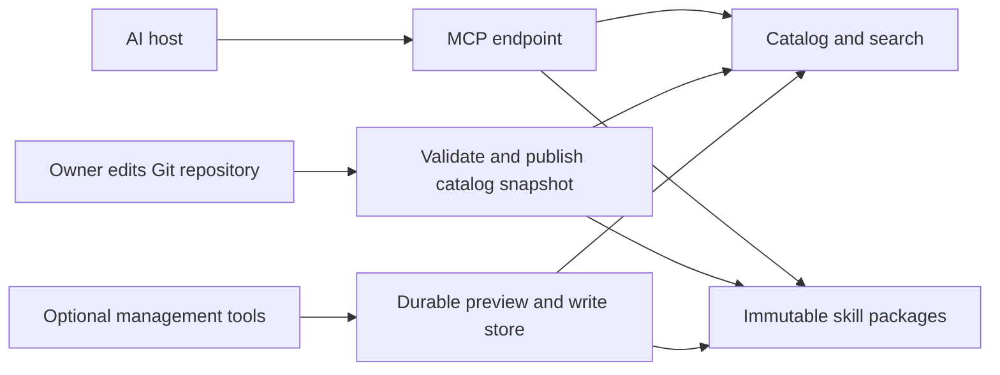

# Personal Skill Library MCP — research and proposed design

Prepared 25 October 2026. Status: design for review; no server has been built, no skills have been imported, and no account changes have been made.

## 1. Recommendation

Build a private, curated library of skills you have chosen. Start with **four retrieval tools** and maintain the collection through a Git repository. Add **four management tools** when you want to curate through chat or a web interface.

The value is your selection, notes, compatibility information, and stable versions. The server should help an assistant find and retrieve the right workflow. The assistant performs that workflow using its own available tools.

There is now an **official MCP Skills extension**, with `skills/list`, `skills/get`, and file retrieval through `resources/read`. Its documentation says SDK and host support is still being implemented. Support it when your chosen SDK and clients support it; retain ordinary MCP tools as a compatibility interface. Do not assume every MCP client supports native remote skills. [Official Skills extension](https://modelcontextprotocol.io/extensions/skills/overview)

All tool names, product limits, schemas, ranking rules, and milestones below are **proposed application design**, unless explicitly attributed to a specification. They are not built-in MCP methods.

## 2. What the library stores

A skill is a directory containing `SKILL.md`, potentially with scripts, references, assets, and other files. Preserve the complete package and original frontmatter. The Agent Skills format requires `name` and `description`; it also defines optional license, compatibility, and metadata fields. [Agent Skills specification](https://agentskills.io/specification)

Keep your curation data separate from the upstream content:

| Field | Purpose |
| --- | --- |
| `skill_id` | Stable library identifier, independent of display name; e.g. `mattpocock/research`. |
| `revision` | Immutable library snapshot identifier; opaque to clients. |
| `name`, `description` | Original skill metadata, preserved rather than rewritten. |
| `source` | Repository, skill directory, requested ref, and resolved commit SHA; or author-upload provenance. |
| `manifest` | Every packaged file, relative path, byte size, MIME type, and SHA-256 digest. |
| `tags` | Your searchable categories, such as `research`, `debugging`, or `frontend`. |
| `personal_notes`, `preferred` | Why you like it and whether to prioritize it. |
| `status` | `active` or `archived`; historical revisions remain available to the owner. |
| `requirements` | Required tools, runtimes, credentials, network access, and agent features. Record unknowns explicitly. |
| `review` | `unreviewed` or `owner_reviewed`, reviewer, timestamp, reviewed revision. This records review, not a safety guarantee. |
| `license` | Declared license and bundled license/attribution file paths; use `unknown` when not established. |

The native extension requires complete file manifests with sizes and SHA-256 digests, and identifies a skill using its originating server and URI. Checksums verify consistency with that manifest; they do not establish that the contents are trustworthy. [Skills extension: integrity and identity](https://modelcontextprotocol.io/extensions/skills/overview)

## 3. Tool inventory

| Priority | Tool | What it does | Access |
| --- | --- | --- | --- |
| MVP | `search_skills` | Find relevant skills for a task. | `skills:read` |
| MVP | `list_skills` | Browse the curated collection deterministically. | `skills:read` |
| MVP | `get_skill` | Retrieve one exact skill and its main instructions. | `skills:read` |
| MVP | `read_skill_file` | Retrieve a supporting reference, script, or asset. | `skills:read` |
| Phase 2 | `preview_skill_import` | Inspect and validate a candidate addition or update. | `skills:write` |
| Phase 2 | `save_skill_import` | Save the exact candidate you reviewed. | `skills:write` |
| Phase 2 | `update_skill_metadata` | Edit your tags, notes, and preferences. | `skills:write` |
| Phase 2 | `set_skill_status` | Archive a skill or restore it to the active collection. | `skills:write` |

Read and write scopes are this application's proposed authorization model. A read-only client should only be offered retrieval tools. Enforce authorization on every request; tool visibility alone does not protect the underlying operation. MCP requires access controls and input validation. [MCP tools specification](https://modelcontextprotocol.io/specification/2026-07-28/server/tools)

### Shared contract

- All inputs are JSON objects. Reject unknown fields and invalid types.
- The authenticated identity determines library ownership. Do not accept an arbitrary `owner_id` argument from the model.
- `revision` is returned on every retrieval. Follow-up file reads must use that exact revision.
- Pagination uses opaque cursors bound to the user, filters, and catalog snapshot. An expired cursor returns `CURSOR_EXPIRED`; restart browsing.
- Read results default to active skills. Archived retrieval requires `include_archived: true` and owner access.
- Proposed initial limits: 20 search results maximum; 50 list entries per page; 256 KiB for main instructions; 1 MiB per supporting file; 128 files and 8 MiB per imported package. These intentionally conservative server limits are not protocol limits.
- The native extension says hosts must support packages up to 512 files / 16 MiB. Our server can serve smaller packages; a future native client we build must meet the host requirements independently. [Extension requirements](https://modelcontextprotocol.io/extensions/skills/overview)
- Successful tool results use `structuredContent` plus a concise text fallback. Business failures use `isError: true` with `{error: {code, message, retryable}}`; malformed protocol calls use MCP/JSON-RPC errors. [Tool result and error formats](https://modelcontextprotocol.io/specification/2026-07-28/server/tools)

Example application error payload:

```json
{"error":{"code":"REVISION_NOT_FOUND","message":"That revision is unavailable. Retrieve the current skill again.","retryable":false}}
```

## 4. Retrieval tool documentation

### 4.1 `search_skills`

**Purpose:** Find skills matching the current task without loading every skill's instructions.

**Use when:** The user describes a task, such as debugging a failing build, without naming a skill.

| Input | Type | Required / default |
| --- | --- | --- |
| `query` | string, 1–500 characters | Required |
| `tags` | string array | Optional; match all supplied tags |
| `capabilities` | string array | Optional; caller-reported available features, e.g. `shell`, `subagents` |
| `limit` | integer, 1–20 | Default 5 |

**Output:** `{matches: [{skill_id, revision, name, description, tags, match_reasons, requirements, compatibility}], total_matches}`. `compatibility` is `compatible`, `missing_requirements`, or `unknown`; absent capability information produces `unknown`, not a promise of compatibility.

**Behavior:** Search active entries by name, description, tags, and personal notes. Rank exact name matches first, then text relevance, then preference as a tie-breaker, then stable ID. Return concise reasons such as matched tags. Do not ask an LLM to invent a confidence score. Begin with keyword search; embeddings can come later if real queries justify them.

**Example:**

```json
{"query":"find the cause of an intermittent API failure","tags":["debugging"],"capabilities":["shell"],"limit":3}
```

```json
{"matches":[{"skill_id":"mattpocock/diagnosing-bugs","revision":"rev_demo_1","name":"diagnosing-bugs","description":"Structured debugging workflow","tags":["debugging"],"match_reasons":["Matched debugging category"],"requirements":["shell"],"compatibility":"compatible"}],"total_matches":1}
```

The descriptions and identifiers in examples are illustrative, not captured upstream records.

**Errors:** `INVALID_INPUT`, `UNAUTHORIZED`. No matches is a successful empty array.

### 4.2 `list_skills`

**Purpose:** Browse what you have saved; unlike search, it does not infer relevance.

**Use when:** “Show my debugging skills,” “What did I add?” or “Browse my favorites.”

| Input | Type | Required / default |
| --- | --- | --- |
| `tags` | string array | Optional; match all |
| `preferred_only` | boolean | Default false |
| `include_archived` | boolean | Default false |
| `limit` | integer, 1–50 | Default 20 |
| `cursor` | string | Optional |

**Output:** `{skills: [SkillSummary], next_cursor, catalog_revision}`. A summary contains `skill_id`, `revision`, `name`, `description`, `tags`, `preferred`, and `status`. No instruction bodies are included.

**Behavior:** Sort by stable `skill_id`. A cursor preserves the catalog snapshot, so edits between pages cannot silently duplicate or skip entries. `next_cursor` is null at the end.

**Example:** `{"tags":["research"],"preferred_only":true,"limit":10}` returns up to ten matching summaries.

**Errors:** `INVALID_INPUT`, `CURSOR_EXPIRED`, `UNAUTHORIZED`.

### 4.3 `get_skill`

**Purpose:** Retrieve the selected skill's main instructions, provenance, requirements, and complete supporting-file manifest.

**Use when:** Search identified a skill, or the user named one directly.

| Input | Type | Required / default |
| --- | --- | --- |
| `skill_id` | string | Required |
| `revision` | string | Optional; resolves to current active revision |
| `include_archived` | boolean | Default false; owner only |

**Output:** `{skill_id, revision, skill_uri, frontmatter, instructions, manifest, source, requirements, review, personal_notes}`. `instructions` includes the original complete `SKILL.md`, not a generated replacement. Each manifest entry includes `path`, `uri`, `sha256`, `size_bytes`, and `mime_type`.

**Behavior:** Resolve the requested revision once, verify stored checksums, and return that snapshot. Surface missing capabilities before the assistant starts following a workflow. Preserve instructions that refer to other skills; flag unresolved dependencies instead of pretending they are available.

**Example:** `{"skill_id":"mattpocock/research","revision":"rev_demo_1"}` returns the frozen research package's metadata, main content, and file list.

**Important:** This compatibility tool returns content. It does not install a skill, grant permissions, execute scripts, or guarantee native activation. The official extension's `skills/get` returns an entry/manifest; its main content is read separately with `resources/read`. Do not confuse those wire contracts. [Native skill loading](https://modelcontextprotocol.io/extensions/skills/overview)

**Errors:** `SKILL_NOT_FOUND`, `REVISION_NOT_FOUND`, `ARCHIVED_SKILL`, `CONTENT_INTEGRITY_ERROR`, `UNAUTHORIZED`.

### 4.4 `read_skill_file`

**Purpose:** Load a reference, script, or asset only when the selected workflow needs it.

**Use when:** `SKILL.md` refers to a checklist, example, template, or helper script.

| Input | Type | Required / default |
| --- | --- | --- |
| `skill_id` | string | Required |
| `revision` | string | Required |
| `path` | relative path | Required; must occur in that manifest |

**Output:** `{skill_id, revision, path, mime_type, size_bytes, sha256, encoding, content}`. `encoding` is `utf-8` for text and `base64` for binary content. Use a resource link instead if the client's media support makes that preferable.

**Behavior:** Resolve paths within the retained skill package; reject absolute paths, `..`, symlink escapes, and paths absent from the manifest. Verify raw bytes before returning. Preserve binary bytes. Return scripts as content; never execute them on the library server.

**Example:** `{"skill_id":"mattpocock/tdd","revision":"rev_demo_1","path":"tests.md"}` reads that supporting file if it is in the snapshot's manifest.

**Errors:** `FILE_NOT_FOUND`, `INVALID_PATH`, `REVISION_NOT_FOUND`, `FILE_TOO_LARGE`, `CONTENT_INTEGRITY_ERROR`, `UNAUTHORIZED`.

## 5. Management tool documentation

These are phase-two features. A Git-managed collection provides the same curation workflow without building write APIs initially.

### 5.1 `preview_skill_import`

**Purpose:** Turn one candidate skill into an immutable preview before adding or updating it.

| Input | Type | Required / default |
| --- | --- | --- |
| `source` | object | Required; one of the shapes below |
| `target_skill_id` | string | Optional; present for an update |
| `expected_revision` | string | Required for an update |

Source examples:

```json
{"type":"github","owner":"mattpocock","repo":"skills","path":"skills/engineering/research","ref":"main"}
```

```json
{"type":"inline","files":[{"path":"SKILL.md","text":"---\nname: my-review\ndescription: Review changes using my checklist.\n---\n\nRead the diff and report actionable findings.\n"}]}
```

The inline source contains exactly one skill root; package it under its validated `name` on storage. A GitHub source points to one directory, not a whole repository import.

**Output:** `{preview_id, candidate_digest, expires_at, source, frontmatter, manifest, validation, warnings, diff}`. `validation` lists errors and whether saving is allowed. `diff` compares against the target revision for updates; it is null for new entries.

**Behavior:** Resolve the requested Git ref to a commit, fetch the entire skill directory within limits, preserve license files, validate frontmatter, inventory script files, and identify obvious missing relative file references. If licensing is not established, flag it for review; do not infer redistribution rights. Missing dependency detection is best effort and must say so. Preview retention: proposed 24 hours in durable storage.

Do not execute candidate code, render instructions as trusted host policy, fetch arbitrary external URLs, or follow repository symlinks outside the package. Start with GitHub and inline text sources; an arbitrary URL importer adds avoidable fetch and authorization complexity.

**Example:** `{"source":{"type":"github","owner":"mattpocock","repo":"skills","path":"skills/engineering/research","ref":"main"}}` returns a reviewable snapshot without activating it in the library.

**Errors:** `SOURCE_NOT_FOUND`, `SOURCE_UNAVAILABLE`, `UPSTREAM_RATE_LIMITED`, `PACKAGE_TOO_LARGE`, `UNSUPPORTED_SOURCE`, `REVISION_CONFLICT`, `UNAUTHORIZED`. Invalid frontmatter can be returned as a non-savable preview with detailed validation errors.

### 5.2 `save_skill_import`

**Purpose:** Commit the exact preview you reviewed, including its complete file set.

| Input | Type | Required / default |
| --- | --- | --- |
| `preview_id` | string | Required |
| `candidate_digest` | string | Required; must match the preview |
| `idempotency_key` | string | Required; unique for this intended save |
| `tags` | string array | Default empty |
| `personal_notes` | string | Default empty |
| `preferred` | boolean | Default false |

**Output:** `{skill_id, revision, status, candidate_digest, created, metadata_revision}`. `created` is false when a valid retry returns the existing result.

**Behavior:** Require an authenticated library owner and their decision to save this snapshot. Validate preview ownership, expiry, checksum, and update preconditions. Store package plus catalog pointer atomically; never refetch a moving branch during save. A retry with the same key and identical arguments returns the original result; changed arguments with the same key fail. Updating content creates a new revision and resets content-review state. Importing does not activate it in any AI client.

**Example:** `{"preview_id":"preview_demo_1","candidate_digest":"sha256:<preview-digest>","idempotency_key":"save-demo-1","tags":["research"],"personal_notes":"My preferred source-backed research workflow","preferred":true}`.

**Errors:** `PREVIEW_EXPIRED`, `DIGEST_MISMATCH`, `VALIDATION_FAILED`, `DUPLICATE_SKILL`, `REVISION_CONFLICT`, `IDEMPOTENCY_CONFLICT`, `UNAUTHORIZED`.

### 5.3 `update_skill_metadata`

**Purpose:** Organize a saved skill without modifying its original instructions.

| Input | Type | Required / default |
| --- | --- | --- |
| `skill_id` | string | Required |
| `expected_metadata_revision` | string | Required |
| `patch` | object | Required; at least one editable field |

Editable patch fields: `tags` (string array), `personal_notes` (string), `preferred` (boolean). A supplied field replaces its previous value; omitted fields remain unchanged. An empty array or empty string clears the field.

**Output:** `{skill_id, metadata_revision, tags, personal_notes, preferred}`.

**Behavior:** Enforce optimistic concurrency and update the search index together with the metadata change. Content revisions and content digests remain unchanged. Metadata edits cannot mark an upstream skill trusted, alter its source, or silently edit its frontmatter.

**Example:** `{"skill_id":"mattpocock/research","expected_metadata_revision":"meta_demo_1","patch":{"tags":["research","documentation"],"preferred":true}}`.

**Errors:** `SKILL_NOT_FOUND`, `INVALID_INPUT`, `REVISION_CONFLICT`, `UNAUTHORIZED`.

### 5.4 `set_skill_status`

**Purpose:** Remove a skill from ordinary discovery, or restore it, without deleting historical content.

| Input | Type | Required / default |
| --- | --- | --- |
| `skill_id` | string | Required |
| `status` | `active` or `archived` | Required |
| `expected_metadata_revision` | string | Required |
| `reason` | string | Optional |

**Output:** `{skill_id, previous_status, status, metadata_revision}`.

**Behavior:** Archiving excludes the entry from default search and list results, and ordinary `get_skill` calls return `ARCHIVED_SKILL`. Owner-authorized historical reads remain possible. Restoring exposes the previously current revision; it does not fetch an upstream update. Repeating the current status is a successful no-op when the revision precondition is valid.

**Example:** `{"skill_id":"mattpocock/research","status":"archived","expected_metadata_revision":"meta_demo_2","reason":"Replaced by my adapted workflow"}`.

**Errors:** `SKILL_NOT_FOUND`, `REVISION_CONFLICT`, `INVALID_INPUT`, `UNAUTHORIZED`.

## 6. Native MCP Skills support

Expose native methods through a separate protocol adapter over the same package store:

| Native surface | Role | Relationship to custom tools |
| --- | --- | --- |
| `skills/list` | Discover complete metadata entries and manifests. | Shares catalog with `list_skills`; must use the extension's actual response schema. |
| `skills/get` | Get an entry by skill URI, independently of listing. | Shares metadata lookup; does not return the custom `get_skill` content envelope. |
| `resources/read` | Retrieve `SKILL.md` or supporting file bytes. | Shares storage and integrity checks with retrieval tools. |
| `resources/directory/read` | Optional direct-child directory browsing. | Defer unless a real client needs it. |

Use revision-specific URIs, e.g. `skill://library/rev_demo_1/research/SKILL.md`, so the parent directory matches the skill name and a follow-up read cannot silently switch versions. Keep a separate lookup from stable library ID to current revision. Native capability declarations, frontmatter preservation, cache metadata, resource manifests, and error behavior must follow the extension rather than the custom API examples here. [Native methods and requirements](https://modelcontextprotocol.io/extensions/skills/overview)

Reading a resource does not by itself activate a skill. Native hosts use their own loading and verification path. The extension also defines consent requirements for activation, nested skills, permissions, and code execution; the server cannot grant those on the host's behalf. This document does not claim current support in any particular client. [Host loading and security requirements](https://modelcontextprotocol.io/extensions/skills/overview)

## 7. Starter skills to curate

These six candidates cover a useful development cycle and come from the collection you already chose to use. They are recommendations to inspect and selectively import, not claims that every workflow fits your preferences. Source links point to mutable `main` for inspection; actual imports should pin a resolved commit.

| Skill | When to use it | Expected result | Requirements and caveats |
| --- | --- | --- | --- |
| **research** | Verify docs, API facts, or a technical choice. | Cited Markdown findings grounded in primary sources. | Requires web access, file writing, and a background agent in the reviewed version. [Source](https://github.com/mattpocock/skills/blob/main/skills/engineering/research/SKILL.md) |
| **diagnosing-bugs** | A reproducible failure or performance regression needs diagnosis. | Reproduction evidence, tested diagnosis, fix verification. | Needs project runtime or a suitable reproduction environment; supporting scripts may matter. [Source](https://github.com/mattpocock/skills/blob/main/skills/engineering/diagnosing-bugs/SKILL.md) |
| **tdd** | You explicitly want a feature or fix developed test-first. | Behavior-focused tests and incremental implementation. | Needs a test runner; the reviewed version requires agreeing test seams and refers to other skill material. [Source](https://github.com/mattpocock/skills/blob/main/skills/engineering/tdd/SKILL.md) |
| **code-review** | Review a diff against standards and requirements. | Separate standards and specification findings. | Needs Git, a comparison ref, relevant specs, and parallel subagents in the reviewed version. It may require tracker setup. [Source](https://github.com/mattpocock/skills/blob/main/skills/engineering/code-review/SKILL.md) |
| **codebase-design** | Decide how to shape a module or testable interface. | Design reasoning using the collection's shared vocabulary. | Its vocabulary is opinionated; preserve linked references and check fit with your project's terminology. [Source](https://github.com/mattpocock/skills/blob/main/skills/engineering/codebase-design/SKILL.md) |
| **pr** | Write a reviewer-facing PR description after implementation. | A concise change description with evidence and risk context. | The reviewed version uses a specific template; writing the body does not itself require publishing a PR. [Source](https://github.com/mattpocock/skills/blob/main/skills/engineering/pr/SKILL.md) |

Start with **research, diagnosing-bugs, and code-review**, then add the rest as needed. If your client cannot delegate, these particular versions of research and code-review need a deliberately adapted copy or a different skill. Label adaptations with their own provenance; do not silently rewrite upstream files.

Later additions should follow your actual projects: frontend UX review, browser verification, database migrations, or deployment checks. Avoid importing overlapping collections wholesale. Record a short trial task and your judgment for every preferred skill.

## 8. Architecture and Vercel hosting



**MVP:** Put selected packages and a separate catalog file in your own Git repository. Validate packages and generate the search index during build. Serve a frozen snapshot from a Next.js MCP route. Git commits provide history and a straightforward review process. No database, embedding model, or internal LLM is necessary for keyword retrieval.

**Phase 2:** Adding or editing skills through MCP requires durable storage for previews, package snapshots, catalog changes, concurrency records, and idempotency results. Do not treat instance memory or deployment-local files as your mutable database. Pick storage separately after deciding whether the library is private, public, or multi-user.

Vercel's deployment guide supports `mcp-handler` and Streamable HTTP. Its Hobby plan is limited to personal non-commercial use, with usage allowances and a five-minute maximum function duration. A small retrieval server is a plausible fit, but free hosting is not an unlimited-service guarantee; upstream API and storage limits also apply. [Vercel MCP deployment](https://vercel.com/docs/mcp/deploy-mcp-servers-to-vercel), [Hobby plan](https://vercel.com/docs/plans/hobby)

For private skills, authenticate the MCP connection and authorize every read, preview, and write. Return private cache policies; do not put private skill contents into a public CDN cache. The native extension's cache metadata must reflect that access model. [Skills extension cache fields](https://modelcontextprotocol.io/extensions/skills/overview)

## 9. What to defer

| Feature | Why defer it |
| --- | --- |
| `execute_skill` | A skill describes a workflow; generic execution needs an agent runtime, permissions, and tools. Retrieval is a smaller and clearer product. |
| Remote `install_skill` | Native installation touches the client's filesystem and discovery paths. Provide a separate client-side installer only when needed. |
| One MCP tool per saved skill | Many entries contain instructions rather than independently executable operations. A small discovery interface scales more cleanly. |
| Autonomous skill selection through an internal LLM | The connected assistant can choose from search results. Additional inference is unnecessary for the first version. |
| Automatic upstream replacement | Upstream changes can alter scripts and instructions. Preview a diff and save a new pinned revision. |
| Permanent deletion | Archive covers routine curation and preserves history. Add retention/deletion policy deliberately if required. |
| Public marketplace, ratings, vector search | Validate usefulness with your own small collection first. |

## 10. Acceptance checks before release

1. A query finds a relevant saved skill; unrelated queries return an empty result rather than invented recommendations.
2. Main instructions load separately from supporting files; every returned file matches its revision's manifest.
3. Two skills with the same name from different sources coexist without silently replacing each other.
4. Missing subagents, shell access, or other known requirements are surfaced; unknown compatibility remains explicit.
5. A source branch moving after preview does not alter what `save_skill_import` saves.
6. Repeating a save after a network timeout creates no duplicate; a stale update cannot overwrite newer content.
7. Archiving and restoring have the documented effects on discovery and historical access.
8. Unauthorized users cannot retrieve private files or commit imports, even by calling handlers directly.
9. Invalid paths, package limits, expired previews, broken references, and upstream failures produce actionable errors.
10. Test the ordinary tools in the chosen MCP client. Test native Skills separately if that client and SDK support it; do not infer one from the other.

## 11. Suggested delivery order

**First usable release:** Curate three skills in Git, preserve their files and sources, build the four read tools, connect one AI client, and test a real task with each skill.

**Next:** Add the official Skills extension when the selected stack supports it and verify its manifests, origin handling, and host-loading behavior.

**Then:** Add the four management tools with durable previews, immutable revisions, authorization, and concurrency controls. A web interface can call those same application services.

## 12. Research basis and limits

This design was checked against the Agent Skills format, the official MCP Skills extension, the MCP tools specification, Vercel deployment/plan documentation, and the six linked upstream skill files. Product scope, rankings, storage choices, and tool contracts are recommendations. No SDK interoperability test, deployment, license audit, or performance benchmark has been performed. Client support and upstream skill contents can change; verify them again at implementation time.
